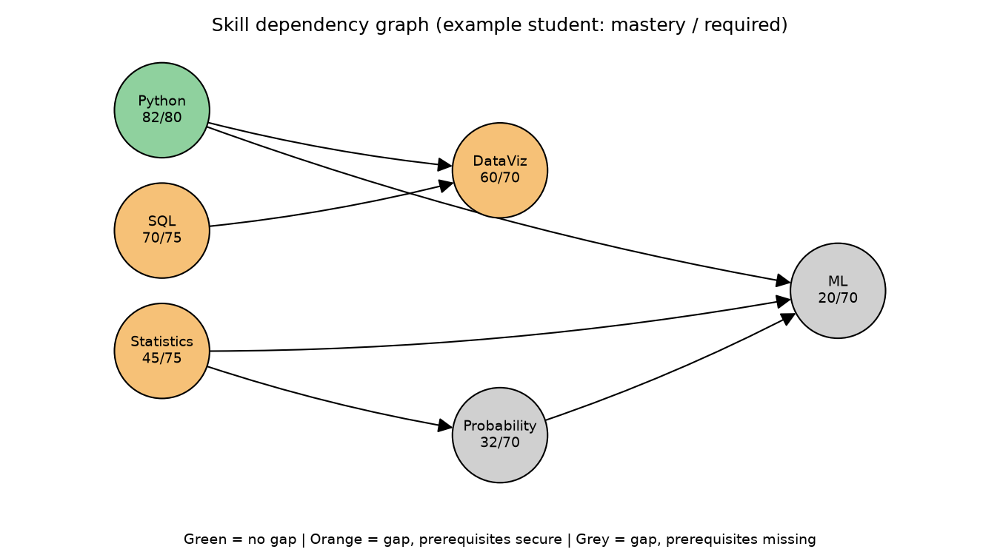
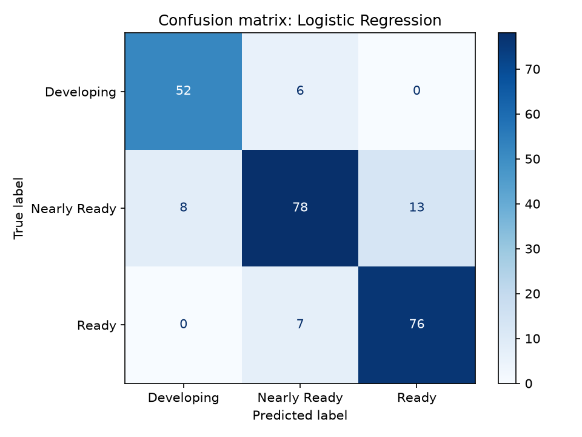

# Skill Hub

An ML-based student career readiness prediction and adaptive skill-gap analysis platform.

## Project links
- **GitHub repository:** https://github.com/Ananya040906/skill-hub
- **Full report (PDF):** [report/Skill_Hub_Case_Study.pdf](report/Skill_Hub_Case_Study.pdf)
- **Results and figures:** [results/](results/)
- **Source code:** [src/](src/)
-

**Course:** Machine Learning for Data Science | VIT Vellore (SCOPE / MID)
**Authors:** Vigasni R, Ananya H Narasimha, Shalini V K

## What it does
- Estimates readiness (Developing / Nearly Ready / Ready) from skill scores
- Computes skill gaps: `Gap = max(0, Required - Mastery)`
- Ranks what to learn next using a prerequisite graph and a priority score

## Data note
The dataset in `data/` is **synthetic**, generated by `src/generate_data.py`.
No real student data is used.

## How to run
```
python -m streamlit run app.py
pip install -r requirements.txt
python src/generate_data.py
python src/gap_priority.py
python src/train_models.py
python src/compare_recommenders.py
```

## Results (synthetic data)

### Model comparison (test set, 240 rows, split by student)
| Model | Accuracy | Precision (macro) | Recall (macro) | F1 (macro) |
|---|---|---|---|---|
| Rule-based baseline | 0.867 | 0.879 | 0.862 | 0.869 |
| Logistic Regression (selected by CV) | 0.858 | 0.859 | 0.867 | 0.862 |

Logistic Regression had the best 5-fold grouped CV score (F1 0.887 ± 0.015),
but it did not clearly outperform the simple rule-based baseline on the test set.




### Recommendation strategies (simulation, 300 students, 6 study sessions)
| Strategy | Gap reduction (mean ± std) | Prerequisite validity |
|---|---|---|
| Graph-aware priority (Skill Hub) | 71.3 ± 25.2 | 100% |
| Weakest-skill-first | 52.7 ± 18.5 | 59.2% |
| Career-relevance-only | 50.1 ± 16.2 | 56.5% |

These results come from synthetic data and a simulated learning model, so
they show the system behaves as designed, not that it works on real students.

## Project files
- `src/generate_data.py`: creates the synthetic dataset
- `src/skill_graph.py`: skills, requirements, prerequisite graph
- `src/gap_priority.py`: gap, priority score, next-skill recommendation
- `src/train_models.py`: model training and evaluation
- `src/compare_recommenders.py`: strategy comparison simulation
- `results/`: output tables and confusion matrix
- `report/`: final case study report (PDF)
